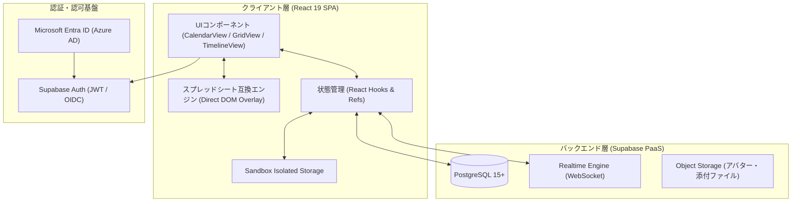
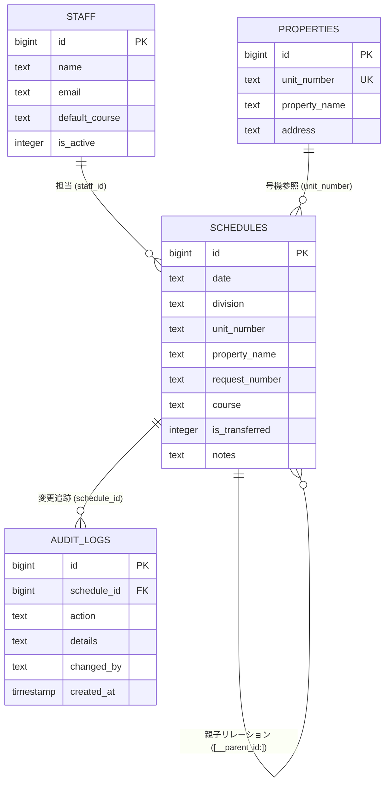
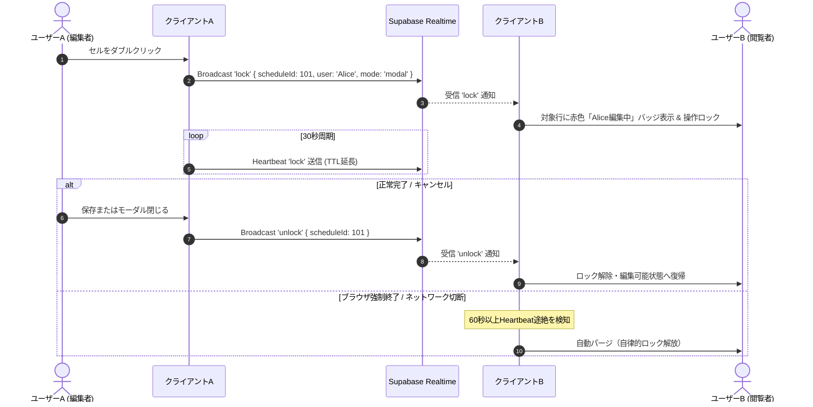

# 現地対応予定・行動管理システム 開発者用技術仕様・運用マニュアル
**Field Schedule Manager - Technical Architecture & Developer Operations Manual**

本書は、「現地対応予定・行動管理システム」の設計思想、システムアーキテクチャ、データモデル、中核エンジンの動作原理、開発環境構築手順、および運用保守規約を網羅した開発者向け公式技術文書である。

---

## 第1章 システム概要と設計思想

### 1.1 システムの存在意義
本システムは、現場対応要員（FTS要員および委託業者）の日々の運行・対応スケジュールを、Googleスプレッドシート同等の高速な操作性をもって統制・管理することを目的とするリアルタイム業務基盤である。従来の表計算ソフトウェアが抱えていた「同時編集時の競合破壊」「モバイル・現場端末からの視認性の低さ」「誤操作による数式・書式の破損」を解消し、業務基盤としての堅牢性と操作性を両立させている。

### 1.2 コア設計原則（Core Architecture Principles）
1. **ゼロ遅延レンダリング（Zero-Latency DOM Interaction）**
   - 膨大なセル選択やドラッグ操作において、Reactの仮想DOM再評価（Re-rendering）に依存せず、DOM直接操作による 0ms 追随オーバーレイアーキテクチャを採用する。
2. **リアルタイム相互排他制御（Distributed Concurrency Control）**
   - Supabase Realtime (WebSocket Broadcast) を活用し、他ユーザーの編集中セル・行をミリ秒単位で分散ロック。同時編集による上書き破壊を物理的に防止する。
3. **データ整合性の多層防護（Multi-Layered Data Integrity）**
   - 不可逆的な全監査ログの自動記録、お試しモード（Sandbox）による本番データ分離、正規化されたリレーショナル制約により、人為的過誤からの回復性を担保する。



---

## 第2章 技術スタックとコンポーネント構成

### 2.1 技術選定一覧
| 分類 | 採用技術 | バージョン / 仕様 | 採用理由・役割 |
| :--- | :--- | :--- | :--- |
| **Frontend Framework** | React | 19.x | 最新の非同期レンダリング、並行モード対応 |
| **Language** | TypeScript | 6.x | 厳格な型安全性の担保、ランタイム例外の撲滅 |
| **Build Tool / Bundler** | Vite | 8.x | 超高速なHMR開発体験、Rollupベースの本番最適化 |
| **Backend / DB** | Supabase | PostgreSQL 15+ | フルマネージドRDBMS、RLS、リアルタイムWebSocket |
| **Realtime Protocol** | Supabase Realtime | WebSocket / Phoenix | 編集ロック（Locks）、行状態変化（Presence）の即時伝播 |
| **Excel I/O** | xlsx-js-style | 1.2.x | 帳票スタイリングを維持した高精度Excel出力 |
| **Icons** | Lucide React | 1.17.x | 軽量・一貫性のあるベクターアイコンセット |
| **Identity Provider** | Microsoft Entra ID | OpenID Connect / OAuth2 | 社内シングルサインオン（SSO）統合 |

### 2.2 ディレクトリ構造
```
field-schedule-manager/
├── frontend/
│   ├── src/
│   │   ├── components/            # 主要ビューおよびモーダル群
│   │   │   ├── CalendarView.tsx    # 月間予定表（週ブロック・マトリクスビュー）
│   │   │   ├── GridView.tsx        # 日別予定表（高機能スプレッドシートビュー）
│   │   │   ├── TimelineView.tsx    # 当日行動予定表（カンバン・時系列ビュー）
│   │   │   ├── ScheduleModal.tsx   # 予定詳細編集モーダル
│   │   │   ├── ScheduleSidePanel.tsx# スライドイン編集サイドバー
│   │   │   ├── PasteImportModal.tsx# 一括TSV貼り付け・マッピングモーダル
│   │   │   └── ...
│   │   ├── types.ts               # データモデル定義・共通ユーティリティ・比較関数
│   │   ├── supabaseClient.ts      # Supabaseクライアント初期化
│   │   ├── App.tsx                # アプリケーション基幹、認証状態、タブ統括
│   │   └── index.css              # グローバルスタイル、テーマ変数定義
│   ├── package.json
│   └── vite.config.ts
├── sql/                           # DDL、インデックス定義、マイグレーションスクリプト
├── docs/                          # 仕様書、技術ドキュメント
├── specification.md               # 累積仕様履歴書（全改修仕様の集大成）
└── walkthrough.md                 # 変更履歴・検証報告書
```

---

## 第3章 データモデルと制約規則

### 3.1 主予定データ (`schedules`)
本システムの最重要テーブルであり、現場対応業務の1レコードを表現する。

| カラム名 | 型 | NULL | 初期値 | 説明・制約条件 |
| :--- | :--- | :---: | :---: | :--- |
| `id` | `bigint` | NO | auto | 代理キー（Primary Key） |
| `date` | `text` | NO | - | 対応日付（`YYYY-MM-DD` 形式） |
| `division` | `text` | YES | `'FTS'` | 区分（`'FTS'`, `'委託'`, `'未定'`） |
| `type` | `text` | YES | - | ロッカータイプ（例: `'KRFC'`, `'通常'` 等） |
| `box` | `text` | YES | - | BOX番号 / BOX数 |
| `unit_number` | `text` | YES | - | 号機番号（5〜6桁数値文字列） |
| `property_name`| `text` | YES | - | 物件名称 |
| `work_type` | `text` | YES | - | 作業種別（`'定期'`, `'障害'`, `'2次'`, `'休暇'` 等） |
| `description` | `text` | YES | - | 作業内容詳細（改行コード含有可） |
| `target_time` | `text` | YES | - | 指定時間（`'13:00'`, `'午前'`, `'終日'` 等） |
| `time_limit` | `text` | YES | - | 時間指定フラグ・期限 |
| `staff_id` | `bigint` | YES | - | 主担当スタッフID（`staff.id` 外部参照） |
| `staff_name` | `text` | YES | - | 主担当スタッフ氏名（キャッシュ） |
| `area` | `text` | YES | - | 担当エリア（市区町村名等） |
| `prefecture` | `text` | YES | - | 都道府県コード / 区分（例: `'23'`, `'都下'`） |
| `transport` | `text` | YES | - | 移動手段（車、電車等） |
| `co_worker` | `text` | YES | - | 同行者氏名（カンマ区切り） |
| `request_number`| `text` | YES | - | FC依頼番号（11桁数値文字列） |
| `course` | `text` | YES | - | コース番号（FTS: 1〜26 固定、27〜89 自動採番） |
| `result` | `text` | YES | - | 対応結果（`'完了'`, `'未対応'`, `'不在'` 等） |
| `started_at` | `text` | YES | - | 着手時刻（`HH:mm`） |
| `completed_at` | `text` | YES | - | 完了時刻（`HH:mm`） |
| `notes` | `text` | YES | - | 備考。親子関係メタデータ `[__parent_id:N__]` を含む |
| `is_transferred`| `integer`| NO | `0` | 行動予定表への移行フラグ（`0`: 未移行, `1`: 移行済） |
| `created_by` | `text` | YES | - | 作成者メールアドレス / 表示名 |
| `updated_by` | `text` | YES | - | 最終更新者メールアドレス / 表示名 |

### 3.2 特殊メタデータ構文（Metadata Specification）
同行者の行分割や親子関係の保持において、データベーススキーマの破壊的変更を回避するため、`notes` フィールド内に暗黙メタデータタグを埋め込む仕様を採用している。

- **構文**: `[__parent_id:{SCHEDULE_ID}__]`
- **動作**:
  - 親予定が作成・更新された際、同行者（`co_worker`）に対して個別の行レコードが生成される。
  - 生成された子レコードの `notes` に上記メタタグが自動付与され、親予定のIDと紐づく。
  - フロントエンド表示時（`cleanMetadata` 関数）において、このメタタグは一般ユーザー向け画面から完全に不可視化（ストリップ）される。



---

## 第4章 中核エンジンのアーキテクチャとアルゴリズム

### 4.1 高速スプレッドシート互換エンジン（Overlay Architecture）
Reactのステート更新による全セル再描画は、数百セルを超える表において顕著なFPS低下を招く。本システムでは、Googleスプレッドシート完全同等の選択枠（Selection Overlay）およびコピー枠（Copy Overlay）を単一の絶対配置DOM要素として管理する。

#### ① 遅延ゼロ・直接DOM幾何学計算
マウスドラッグやキー移動による選択範囲の変更時、`updateSelectionOverlayDom` 関数が直接ターゲットセルの `getBoundingClientRect()` を計測し、`transform: translate3d(x, y, 0)` によりGPUアクセラレーションを効かせて描画を更新する。Reactのレンダリングサイクルを一切経由しないため、遅延は物理限界値である 0ms を達成する。

#### ② 表示倍率（CSS `zoom`）環境下での幾何学補正アルゴリズム
画面全体の縮小・拡大表示時、親要素に CSS `zoom: N%` が適用される。この環境下で `getBoundingClientRect()` が返すビューポート物理ピクセルをそのままローカル座標系に代入すると、ブラウザの再乗算によって選択枠が二重に縮小・拡大され、甚大な座標ズレが発生する。

> [!IMPORTANT]
> **座標除算補正（Scale Invariant Transformation）**:
> スクロール量および親コンテナ基準の座標差分を、必ず表示倍率スケール（`scale = zoomLevel / 100`）で除算してローカル座標を算出する。
>
> $$\text{left} = \frac{\min(\text{start.left}, \text{end.left}) - \text{container.left}}{\text{scale}}$$
> $$\text{top} = \frac{\min(\text{start.top}, \text{end.top}) - \text{container.top}}{\text{scale}}$$

#### ③ 循環パーセンテージ解決（Cyclic Dependency）の完全排除
`display: flex` コンテナ内部で CSS `zoom` を適用した際、子要素に `width: max-content` を指定し、さらにその内部のテーブルに `width: 100%; table-layout: fixed;` を組み合わせると、Chromium（Chrome / Edge）のレイアウトエンジンが循環参照を起こし、テーブル幅が **1,111,111 ピクセル** に肥大化して内容が消失するブラウザ固有のバグが存在する。
- **恒久対策**: 予定表コンテナにおいては `width: max-content` を完全撤廃し、常に `width: 100%; min-width: 1380px;` の絶対下限を定義して循環計算の発生を物理的に遮断している。

---

### 4.2 業務標準多段ソートアルゴリズム (`compareSchedules`)
実務現場における配車・巡回計画の優先順位を厳密にコード化した比較関数である。[types.ts](file:///C:/Users/000644/.gemini/antigravity/scratch/field-schedule-manager/frontend/src/types.ts) 内に実装され、日別・月間の全ビューで完全統一されている。

```typescript
export const compareSchedules = (a: Schedule, b: Schedule): number => {
  // 第1階層: 区分優先度 (FTS: 1 -> 委託: 2 -> 未定: 3)
  const divOrder: Record<string, number> = { 'FTS': 1, '委託': 2, '未定': 3 };
  const divA = divOrder[a.division || ''] || 99;
  const divB = divOrder[b.division || ''] || 99;
  if (divA !== divB) return divA - divB;

  // 第2階層: コース番号数値昇順 (未設定は末尾)
  const courseA = parseInt(a.course || '', 10);
  const courseB = parseInt(b.course || '', 10);
  const hasCourseA = !isNaN(courseA);
  const hasCourseB = !isNaN(courseB);
  if (hasCourseA && hasCourseB) {
    if (courseA !== courseB) return courseA - courseB;
  } else if (hasCourseA) return -1;
  else if (hasCourseB) return 1;

  // 第3階層: エリア文字列昇順 (日本語50音順)
  const areaA = (a.area || '').trim();
  const areaB = (b.area || '').trim();
  if (areaA !== areaB) return areaA.localeCompare(areaB, 'ja');

  // 第4階層: 号機番号昇順
  const unitA = (a.unit_number || '').trim();
  const unitB = (b.unit_number || '').trim();
  return unitA.localeCompare(unitB, 'ja');
};
```

---

### 4.3 リアルタイム分散排他ロック（Realtime Distributed Lock）
複数端末・複数ユーザーによる同一予定行の同時編集破壊を未然に防ぐため、Supabase Realtime Broadcast チャンネル（`locks-channel`）を用いた分散ロックプロトコルを実装している。



---

## 第5章 開発・運用プロトコル（Git Flow & CI/CD）

### 5.1 ブランチ戦略規約
本プロジェクトは、稼働中の実運用環境（現場作業者が日々アクセス中）を保護するため、厳格な二系統ブランチモデルを採用する。

> [!CAUTION]
> **本番直コミットの絶対禁止**:
> 開発者のローカル作業ブランチは原則として常時 `develop` に維持しなければならない。ユーザーからの明確な「本番環境へ適用」の指示がない限り、`main` ブランチへのマージおよびプッシュは固く禁ずる。

| ブランチ名 | 保護レベル | 役割・運用規則 |
| :--- | :---: | :--- |
| `main` | **最高保護** | 本番稼働ブランチ。Vercel等へ自動デプロイされる。検証が完了し、ユーザー承認を得たコードのみを Fast-Forward マージする。 |
| `develop` | **通常開発** | 開発・先行検証ブランチ。新規機能の実装、不具合修正、ヘッドレスブラウザによる検証はすべてここで行う。 |
| `feature/*` | **作業用** | 大規模機能開発時に `develop` から分岐して使用する。 |

### 5.2 コミットメッセージ規約（Conventional Commits 準拠）
コミットメッセージは、変更の意図を明確にするため以下のプレフィックスを必須とする：
- `feat:` 新機能の追加、仕様拡張
- `fix:` 不具合の修正、バグフィックス
- `docs:` 仕様書（`specification.md`）、変更履歴（`walkthrough.md`）、マニュアル等の文書更新
- `refactor:` 振る舞いを変えない内部コードの整理・構造改善
- `style:` コードフォーマット、CSSの微細な調整
- `test:` 自動テストスクリプト、検証コードの追加

### 5.3 必須ドキュメント運用規則
本システムでは、コード修正時に以下の2つの文書を**同一コミットまたは直後のコミットで常時更新すること**がシステム規約として義務付けられている：
1. **[specification.md](file:///C:/Users/000644/.gemini/antigravity/scratch/field-schedule-manager/specification.md)**: 各改修の技術仕様、背景、原因、影響範囲を章立てて永続記録する。
2. **[walkthrough.md](file:///C:/Users/000644/.gemini/antigravity/scratch/field-schedule-manager/walkthrough.md)**: ユーザーからの指摘内容、調査過程、ビルド結果、検証スクリーンショットを時系列で記録する。

---

## 第6章 環境構築と検証手順

### 6.1 前提環境要件
- **OS**: Windows 11 / macOS / Linux
- **Node.js**: v20.x 以上（推奨: v22+ または v24）
- **npm**: v10.x 以上
- **Headless Browser**: Microsoft Edge または Google Chrome（CDP検証用）

### 6.2 開発環境のセットアップ手順
```bash
# 1. リポジトリのクローン
git clone https://github.com/ktomimoto-create/field-schedule-manager.git
cd field-schedule-manager

# 2. develop ブランチへの切り替え
git checkout develop

# 3. フロントエンド依存関係のインストール
cd frontend
npm install

# 4. 環境変数の設定
# frontend/.env.local を作成し、Supabase接続情報を設定
cat << 'EOF' > .env.local
VITE_SUPABASE_URL=https://llbefroolkndlyziiqgi.supabase.co
VITE_SUPABASE_ANON_KEY=sb_publishable_v17bk3WZ5NQp6IVcEjrXag_mINgvJHQ
EOF

# 5. 開発サーバーの起動
npm run dev -- --host
```

### 6.3 本番ビルド検証手順
コードの変更後は、コミット前に必ずローカルで TypeScript 型検査およびバンドル整合性を検証する：
```bash
# frontend ディレクトリにて実行
npm run build
```
> 出力結果において `tsc -b` の型エラーが 0 件であり、`vite build` によるバンドル成果物が `dist/` に正常出力されることを確認する。

---

## 第7章 トラブルシューティングと障害対応

### 7.1 よくある障害事象と根本解決策

#### Q1. 表示倍率を変更した際にセル選択枠が上端や画面外へズレる
- **原因**: 親要素の CSS `zoom` と `getBoundingClientRect()` の物理ピクセル差分が二重計算されている。
- **対処**: `scale = zoomLevel !== 100 ? (zoomLevel / 100) : 1` を用いて、すべての差分ピクセル（left, top, right, bottom）を除算補正しているか確認する。

#### Q2. 予定表（グリッド）で文字やヘッダーが消え、薄いストライプのみが表示される
- **原因**: ズームコンテナ（`.grid-table-zoom-inner`）に `width: max-content` が指定され、子要素の `<table style="width: 100%; table-layout: fixed;">` との間で Chromium の循環パーセンテージ解決バグが発生し、幅が111万pxに肥大化している。
- **対処**: ラッパー要素のスタイルを `width: '100%', minWidth: '1380px'` に固定し、循環参照を遮断する。

#### Q3. セルをクリックした際に直前の行選択状態が解除されてしまう
- **原因**: `handleCellMouseDown` 内で修飾キー（`e.ctrlKey || e.shiftKey`）の判定を行わずに一括クリア処理が走っている。
- **対処**: 修飾キー押下時はクリアをバイパスし、`handleSelectRow` を直接中継する。また、MouseDown と Click の二重発火を 250ms デバウンスガードで防護する。

---

## 第8章 セキュリティ・監査ログ規約

### 8.1 監査証跡（Audit Trail）の保全
本システムにおける予定の追加・変更・削除・一括転送操作は、すべて `audit_logs` テーブルに不可逆的に記録される。
- **記録項目**: 操作種別（`action`）、対象予定ID（`schedule_id`）、物件名（`property_name`）、操作詳細（`details`）、操作者識別子（`changed_by`: メールアドレスまたは表示名）、発生日時（`created_at`）。
- **完全性の保持**: `audit_logs` に対する UPDATE および DELETE はデータベース権限レベルで拒絶され、履歴の改ざんを不可能としている。

### 8.2 お試しモード（Sandbox Isolation）のセキュリティ
開発者・作業者が安全に動作検証を行えるよう実装された「お試しモード」は、以下のプロトコルにより本番データベースから物理的に隔離される：
- お試しモードフラグが `true` の場合、Supabase に対するすべての INSERT / UPDATE / DELETE リクエストはブロックされる。
- 代替として、ブラウザの `localStorage`（キー: `field_app_sandbox_schedules`）およびメモリ上の React State のみが更新される。
- これにより、本番運用データに対する誤操作リスクを 100% 排除している。

---
*本書記載の仕様は、コミット `59b0972` 時点のマスター実装に完全準拠している。*
